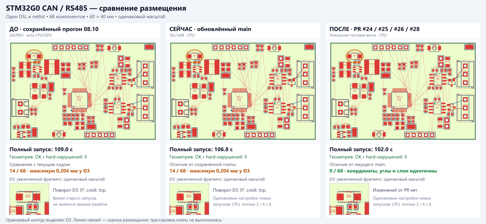

# Проверка открытых PR и STM32CAN — 20 октября 2026

## Исходное состояние и границы проверки

- `origin/main` после `git fetch` и `git pull --ff-only`: `3bc1a081e31dcc083203e577ce7480862de33062`; обновлений относительно локального `main` не было.
- Исходные 12 файлов `docs/experimental/analyze/` сохранены в отдельной ветке `feat/analysis`, коммит `e26b416`. Этот отчёт также находится в `feat/analysis`.
- Для эксперимента создан отдельный checkout `../eda-copilot-backend-pr-review`, ветка `review/prs-2026-10-20`, итоговый commit `70d090740582e2b2f3d08a30ae8b713ed7e5835d`. В ней локально объединены #24, #28, #25 и #26; production-код основной рабочей копии не изменён.
- Проверены все четыре исходных открытых PR автора DivagoNM, их diff, описания, связанные issues, комментарии владельца и статусы CI. Во время проверки появился #29 (создан в 10:29 МСК): он разобран отдельно и не входит в полный STM32 benchmark четырёх исходных PR. GitHub merge/close/comment не выполнялись.
- Это проверка корректности и регрессий размещения, а не подтверждение электрической работоспособности изготовленной платы. Трассировка не запускалась.

## Решения по PR

| PR / проверенный head | Что делает | Польза | Риск и проверка | Рекомендация |
|---|---|---|---|---|
| [#24](https://github.com/biosshot/eda-copilot-backend/pull/24), `01fe52f` | Расширяет GPU-тесты: ground в больших блоках, high compactness, board edge bias, flexible paths | Высокая для защиты численного контракта CPU/GPU; production-поведение не меняется | Низкий. Только тесты и документация. Все 5 затронутых GPU-сценариев прошли на RTX 3060; это именно выполненные тесты, не skipped | Мержить первым. Отдельного issue, который этот PR закрывает, нет |
| [#28](https://github.com/biosshot/eda-copilot-backend/pull/28), `a5961bf` | Проверяет декларации по исходному DSL, исправляет preview/preserve, наследование module, обработку malformed entries и attachment cycles | Убирает ложные предупреждения и улучшает DSL skeleton | Низкий. Все 11 профильных тестов прошли; native placement/scoring не изменены. Ответ диагностики намеренно меняется при декларациях | Мержить. Follow-up к уже merged #22; frontend PR biosshot/easyeda-copilot#78 независим |
| [#26](https://github.com/biosshot/eda-copilot-backend/pull/26), `5a34149` | Округляет рабочие pad-access rows при загрузке, сохраняя исходные rows для последующих поворотов | Исправляет реальное различие CPU/GPU из #16, воспроизведённое локально | Ограниченное изменение CPU scoring, поэтому нельзя обещать одинаковые scores на любой плате. H743 после исправления проходит строгий GPU verifier без fallback; CPU/GPU и CPU до/после дают одинаковый полный результат | Мержить; затем закрыть #16 через merge |
| [#25](https://github.com/biosshot/eda-copilot-backend/pull/25), `453130f` | Переносит финальное выравнивание в Rust, добавляет incremental route cache и параллельную оценку | Высокая: устраняет дорогой цикл TS → native; STM32 измеряется отдельно ниже | Обнаружена воспроизводимая регрессия накопленных перемещений. Зелёный CI и совпадение STM32 не доказывают общую идентичность | Пока не мержить. Исправить состояние валидатора, добавить regression test на несколько пар/проходов, повторить проверки. #19 оставить открытым |
| [#29](https://github.com/biosshot/eda-copilot-backend/pull/29), `ead6ede` — появился во время проверки | Нормализует разницу между F32 edges в пределах ошибки представления, убирая зависимость clearance boundary от координаты | Исправляет реальный ложный overlap при переносе/центрировании; локальный scalar repro подтверждает исправление | Меняет физический предикат CPU/GPU. Автор сообщает 17 изменившихся block placements, но приводит replay прежних native inputs, не новые конечные платы | Повременить до отдельной приёмки геометрии и полных before/after CPU/GPU layouts. Это не изменение с гарантией идентичного результата; самостоятельного закрываемого issue не указано |

У каждого из пяти проверенных heads по 8 успешных CI jobs: Windows, Linux, macOS arm64/x64, Node 20/24. В конце проверки повторно проверены heads: новых коммитов не появилось. Ни один из пяти PR не добавляет зависимости, install hooks, shell/network операции или изменения CI permissions. Основной риск #25 — корректность численного алгоритма и проверок, а не доступ к данным.

По #29 отдельно скомпилированы реальные `geometry_policy.rs` до/после и общий `compute/numerics.rs`, без переписывания формулы. Для H743 пары при двух on-grid координатах старый код даёт `0` и `0.0010000244`, новый — `0` и `0`. Все 11 scalar unit tests этих файлов проходят, включая новый sweep границы на 2700 origins. Это не проверка native addon целиком, GPU kernels или итоговых плат с #29. Авторские 698 replay inputs также не доказывают качество новых полных layouts, поскольку изменённые блоки породят другие входы последующих стадий.

## Воспроизводимое замечание к #25

**P2: native validation проверяет только текущую пару относительно исходной платы и теряет уже принятые перемещения других блоков.**

В `board_alignment.rs:877–881` в `ChangeCheck::check()` передаётся только `candidate.moved`. `ChangeScratch` создаётся из исходного `before` (`post_place_refine.rs:1327`), а после принятого хода обновляются `current` и `scratch.world`, но не состояние native-validator (`board_alignment.rs:1085–1086`). Старый код передавал в `validatePlacementChange` полный текущий массив placements.

Независимый тест:

- Четыре одинаковых индуктора из существующего Telemetry fixture, отдельные блоки.
- Начальные x: `[-30, -10, 10, 30]`, y: `[0, 1, 2, 3]` мм.
- Модуль первых двух блоков: `hardBbox: true`, `maxHeight: 13.5`.
- Связи очищены, чтобы изолировать выравнивание и ограничение группы.

| Показатель | Исходный TS-pass | PR #25 |
|---|---:|---:|
| Принятых перемещений | 5 | 4 |
| Оценённых кандидатов | 702 | 585 |
| Отказов native-validator | 0 | 91 |
| Конечные y L1/L2/L3/L4, мм | 1.5 / 1.625 / 1.875 / 2 | 1 / 1 / 1.5 / 1.5 |
| Итоговый alignment objective | 0.005 | 0.06125 |
| Полная проверка допустимости результата | проходит | проходит |

Максимальное расхождение координат — 0.625 мм. Результат PR одинаков при 1 и 4 потоках: причина не в гонке потоков. В расширении до 108 детерминированных случаев найдено 7 расхождений; недопустимого конечного размещения в этой выборке не найдено. Поэтому вывод ограничен доказанной потерей parity и лишними отказами; физически небезопасный результат по этой проверке не заявляется.

Исправление должно передавать валидатору накопленное состояние текущей платы либо полный набор отличий от исходного baseline, включая предыдущие принятые пары. Проверить и серийную, и параллельную ветви, несколько пар, второй проход, hard module/family/anchor constraints. После этого сохранить сравнение placements, moves, evaluated и rejection counters с TS-reference.

Воспроизведение из корня PR-checkout с его пересобранным native addon:

```powershell
node --import tsx ../eda-copilot-backend/docs/experimental/pcb/pr-review-2026-10-20/reproduce-pr25.mjs
```

Ожидаемый exit code на проверенном PR — 1 с `REGRESSION` и координатами выше. Вход и TS-reference сохранены в [alignment-counterexample.json](alignment-counterexample.json), проверка — [reproduce-pr25.mjs](reproduce-pr25.mjs).

## Issues и порядок завершения

1. **#24 → #28:** независимые небольшие PR, пригодны к merge. Закрывать их без merge оснований нет.
2. **[#16](https://github.com/biosshot/eda-copilot-backend/issues/16) → #26:** владелец уже явно выбрал округление при загрузке, сохранив authored geometry. Закрыть issue после merge #26; отдельно до merge не закрывать.
3. **[#19](https://github.com/biosshot/eda-copilot-backend/issues/19) → #25:** архитектурное направление соответствует выбору владельца (Rust, не process pool), но реализация требует исправления выше. Issue пока нужен.
4. **[#17](https://github.com/biosshot/eda-copilot-backend/issues/17):** оставить открытым как обсуждение macOS/Metal. В свежем комментарии автор уже описал локальный Metal-прототип; открытого PR для него пока нет. Его собственные измерения показывают замедление полного запуска. Разумный следующий объём — opt-in Metal с численными admission probes, CPU fallback и сборкой без требования Vulkan SDK; включение по умолчанию отложить.
5. **[#27](https://github.com/biosshot/eda-copilot-backend/issues/27):** отложить в backlog до согласования контракта. Разделить декларативные ограничения/валидацию и новые профили scoring. Последние намеренно меняют оптимум, требуют отдельных эталонов и не относятся к текущей задаче сохранения результата. Не закрывать как «исправлено»: реализации нет.

[#20](https://github.com/biosshot/eda-copilot-backend/issues/20) уже закрыт; повторного действия не требуется. Остальных открытых issues в снимке репозитория не было.

## Методика STM32CAN

Fixture: `tests/pcb-layout/STM32G0_CAN_RS485`. 68 компонентов, 60×40 мм, все компоненты сверху. Сохранённый полный прогон: `debugging/pcb-layout/runs/STM32G0_CAN_RS485/2026-10-08T13-59-53-172Z`, commit `2e2f96394f9521c609ed02d0368f57a2b2745da0`.

JS DSL, JSON netlist и TS fixture runner старого прогона совпадают с текущими файлами побайтно. Hash resolved input также совпадает: `9fc531b67ae032ecf7077bcec9cef90be686b4876ef39931122199e9b052ca47`.

Хост: Windows, AMD Ryzen 5 5600H, 6 физических / 12 логических ядер, RTX 3060 Laptop GPU, driver 610.88; Node 26.5.0, Cargo 1.98.1. Native addon пересобран из исходников для каждой версии; прежний локальный бинарник был от 14 октября и для нового baseline не использовался.

Новые запуски выполнены последовательно, без конкурирующей сборки или тестов:

```powershell
$env:PCB_LAYOUT_SUBTREE_WORKERS='2'
$env:PCB_BOARD_PACKER_THREADS='4'
$env:PCB_POST_PLACE_THREADS='4'
$env:PCB_BLOCK_BACKEND='cpu'       # GPU pass: cubecl
$env:PCB_BOARD_BACKEND='cpu'       # GPU pass: cubecl
$env:PCB_POST_PLACE_BACKEND='cpu'   # GPU pass: cubecl
npm run debug:pcb-layout -- capture STM32G0_CAN_RS485
```

Persistent solve cache не включён. Использован один полный проход на версию/backend; это наблюдаемые single-pass timings, не статистическая медиана. Сборка не входит во время. Полное время включает запуск Node, parsing, получение footprints, graph, solver, SVG, assembly и report. Старое время с `auto` и прежними настройками не используется для расчёта ускорения открытых PR.

Проверяется не только PNG: конечные x/y/rotation/layer, tree-stage placements, native inputs/solutions по точному input hash, финальный alignment result, геометрические нарушения и hard hints. В native-response сравнении исключён `profile` с измерениями времени; counters alignment проверяются отдельно.

## Результаты

| Версия | Полный запуск | Геометрия | Отличия от нового main CPU |
|---|---:|---|---|
| Сохранённый 08.10, auto | 109.04 с | OK | 14/68 координат; максимум 0.204 мм, D3 |
| Текущий main, CPU | 106.84 с | OK | baseline |
| Текущий main, принудительный GPU | 134.52 с | OK | 0/68; все 74 сопоставленных native solutions совпали |
| #25 + #24 + #28, CPU | 102.94 с | OK | 0/68; все 74 native solutions совпали |
| #24 + #25 + #26 + #28, CPU | 101.95 с | OK | 0/68; все 74 native solutions совпали |
| #24 + #25 + #26 + #28, GPU | 81.62 с | OK | 0/68; все 74 native solutions совпали |

Все пять свежих запусков имеют одинаковые resolved inputs, tree-stage placements, конечные placements и полный alignment result (включая 797 кандидатов, 3 принятых хода и counters). На этой плате открытые исходные PR не улучшили и не ухудшили расположение: оно точно совпадает с новым main.

Наблюдаемое изменение полного времени относительно main на том же backend: CPU **−4.6%**, GPU **−39.3%**. Это не обещание ускорения других плат/машин. В CPU-версии один только `auto_place` оказался немного медленнее: main 93.17 с, #25 95.60 с; часть итогового выигрыша связана с более быстрыми footprint/graph стадиями.

В исходном полном CPU capture board packing замедлился с 32.54 до 44.04 с. Из-за этого выполнен один отдельный replay точного сохранённого board input каждым бинарником, с 4 потоками и одинаковым profiling: main 34.19 с, #25 36.77 с (**+7.5%**), ответы byte-identical. Это дополнительный сигнал проверить регрессию общего hot path на Windows после исправления #25, а не заявлять гарантированные −30% CPU по Apple-измерениям автора. Повтор полного fixture для этого не делался.



Машинные результаты, source/native hashes, пути captures, метрики и сравнения: [comparison.json](comparison.json).

Повороты и слои между историей и main не изменились. Большинство смещений — 0.001–0.004 мм; D3 сдвинулся на 0.204 мм. По оценке существующего `placementMetrics`: crossings 60 → 60, foreign-pad hits 103 → 103, длина MST связей 653.62 → 653.65 мм. Это практически одинаковое качество, а не доказанное улучшение трассировки. Rust global score, пересчитанный одной текущей реализацией для обеих геометрий: 20731.834 → 20731.584.

В каждом из этих результатов: 0 overlaps/outside-board/hole/region/layer/unplaced violations, 0 нарушений explicit hard hints. Существующие 13 soft hint violations остаются; `placementOk=true` не следует читать как отсутствие любых advisory diagnostics.

## Проверки

- Baseline `npm run test:pcb`: 528 tests, 488 pass, 40 skip, 0 fail.
- Объединённые #24/#28/#25/#26: `npm run build`, `npm run typecheck` и полная GPU-enabled native release сборка проходят; `npm run test:pcb`: 543 tests, 499 pass, 44 skip, 0 fail.
- Rust `cargo test --release --no-default-features` на объединённых PR: 79 pass, 1 fail — `interval::tests::outward_bounds_survive_ftz_and_cancellation`, `interval.rs:83`. Тот же тест отдельно запущен на неизменённом main и падает на том же assertion. Файл `interval.rs` в этих PR не менялся; это существующая проблема baseline, не новая регрессия PR. Поэтому весь Rust suite нельзя объявлять зелёным.
- #28 `pcb-schematic-declarations.test.ts`: 11/11 pass; typecheck pass.
- #24 выбранные новые GPU-сценарии: 5/5 pass, 0 skip; реальные CUDA/GPU проверки на RTX 3060.
- #16 до исправления: H743 `usb_cc`, `PCB_BLOCK_GPU_VERIFY=1` воспроизводит `CPU=2016.4834 GPU=2016.545`, завершаясь ошибкой проверки.
- #16 после #26: тот же H743 input проходит CPU и GPU с verifier, без fallback; полные CPU/GPU solutions равны, и CPU solution совпадает с baseline. Итоговый score 2090.879150390625, hardCount 0.
- #25 независимый multi-pair regression: расхождение воспроизведено; при 1 и 4 потоках одинаково.
- #25 авторские `pcb-board-alignment-native.test.ts`: 6/6 pass, несмотря на отдельную регрессию выше.
- #29 standalone scalar tests исходных файлов: 11/11 pass; полный benchmark/GPU-проверка #29 не выполнялись.

Полные локальные captures, сборочные логи, ответы GitHub API и машинное сравнение находятся в `debugging/pr-review-2026-10-20/` основной рабочей копии; логи и repro #25 — в `debugging/` отдельного checkout.

В отчёте сохранены сводки H743 [до](h743-before-summary.json) и [после](h743-after-summary.json), вход и воспроизведение #25, машинное сравнение STM32 и PNG. Исходные и появившиеся во время работы сторонние изменения в `docs/experimental/analyze/` не включались в коммит этого отчёта.
